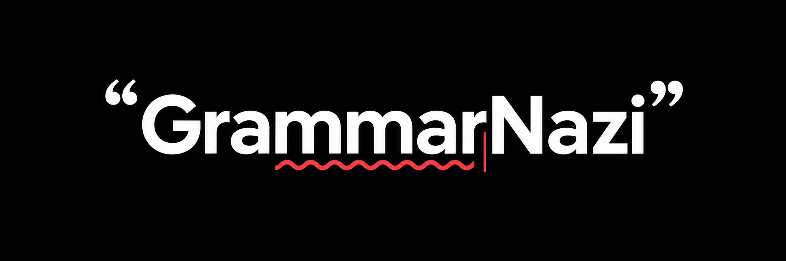
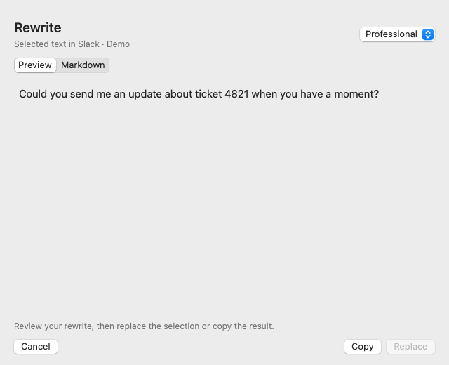
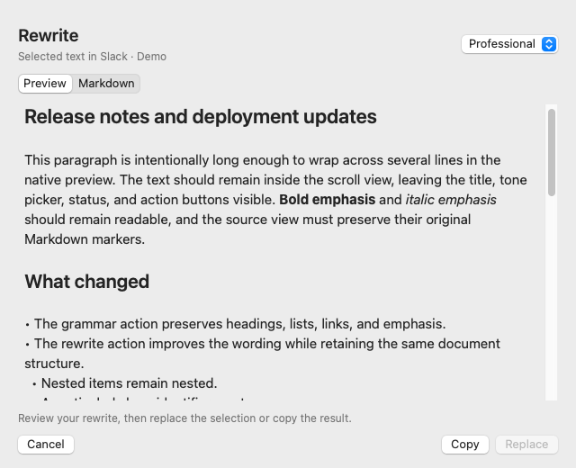
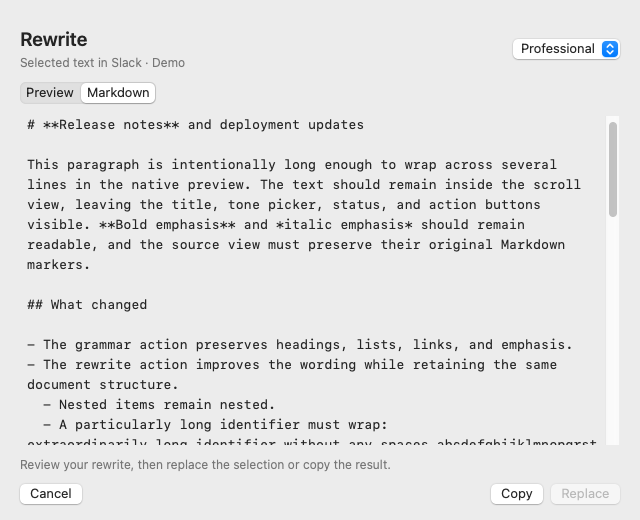

# GrammarNazi

**Clearer writing. Private by design.**

Polish a Slack message, tighten a draft, or find a friendlier way to say it—all on your Mac. GrammarNazi fixes grammar and rewrites selected text using local AI, with a preview that puts you in control of every change.

- **Edit locally.** Qwen runs inside the native app with Metal acceleration. Editing works offline after setup.
- **Choose your tone.** Rewrite in Natural, Professional, Friendly, or Concise styles while preserving your meaning.
- **Keep your formatting.** Edit Markdown prose while preserving headings, lists, links, emphasis, and code.
- **Review every change.** Copy the result or replace your selection when you're ready. Cancel leaves your draft as it was.

Built for **Apple Silicon and macOS 15+**. Launch from **Raycast Script Commands** or **Tinycast 0.9.7-sequoia Custom Commands**.

## Privacy built into the workflow

GrammarNazi processes selected text inside the app on your Mac. It does not send selections to a cloud AI service, and no AI account or API key is required. Inference requests and responses stay in memory; the app saves no selected text or editing history, and runtime prompt logging is disabled. Your preferred rewrite tone and model idle timeout are saved locally.

Setup needs an internet connection to download the model and runtime source. Once built, the app runs locally without an inference server or separate background model daemon. Closing the preview clears its text and keeps the loaded model ready for your next edit. By default, the app unloads the model and quits after 15 minutes idle.

You grant macOS Accessibility access so GrammarNazi can read and replace your selection. Some apps require a temporary clipboard copy to capture text, and replacement uses the clipboard to paste your edit. The previous clipboard is restored unless another app has changed it; **Copy** intentionally leaves your result there. Clipboard managers can observe these operations. Password fields and Secure Input are refused.

## Screenshots

See your rewrite before it reaches your draft. Choose a tone, review the result, then copy or replace your selection. Screenshots use demo text.



Review long passages in a scrollable preview while the action buttons stay visible. Switch between formatted text and the exact Markdown source you will copy or paste.

| Formatted preview | Markdown source |
| --- | --- |
|  |  |

## Edit where you write

1. Select a passage in your app.
2. Run **Fix Grammar (Selection)** or **Rewrite (Selection)** from Raycast or Tinycast, or assign a global shortcut in your launcher.
3. A floating preview shows the result. **Return / Replace** pastes over the selection, **⌘C / Copy** copies the result, and **Escape / Cancel** closes it.

The preview is a non-activating macOS panel so the original app can keep its selection. Rewrite offers Natural, Professional, Friendly and Concise tones; changing the tone regenerates from the original passage. Repeating a command while its preview is open brings that preview forward.

Selection capture first uses Accessibility, enabling the accessibility tree for Electron apps such as Slack. If the app does not expose selected text, the app briefly sends ⌘C and restores the clipboard. A clipboard change must be observed; an unchanged clipboard is never treated as a selection. Replacement checks the original app, selected text, and any available window, field and selection range. A mismatch keeps the preview open with Copy available. Replacement sends ⌘V and never Return into the source app, so it does not submit a Slack message.

## Get started

Requires macOS 15+, Apple Silicon, Node 22+, CMake 3.24+, and Xcode Command Line Tools for building. Install CMake with `brew install cmake`, or set `CMAKE` to its executable path. Build tools are needed only to create the app; installed commands run natively.

```sh
brew install cmake
cmake --version # Must be 3.24 or newer.
npm ci --ignore-scripts
npm run setup
npm run build:selection
npm run install:selection
```

The installer places **GrammarNazi.app** in `~/Applications/`, installs the two Raycast scripts, and registers Tinycast Custom Commands when Tinycast is installed. Choose either launcher; both open the same native preview.

### Raycast

The installer writes **Fix Grammar (Selection)** and **Rewrite (Selection)** to:

```text
~/Library/Application Support/GrammarNazi/raycast/
```

In Raycast Settings, open **Script Commands**, choose **Add Script Directory**, and select that folder once. Use **⌘⇧G** in the folder chooser to paste the path. The commands appear under **GrammarNazi**; assign hotkeys or aliases in Raycast. Raycast automatically picks up script changes in registered directories. See the [official Script Commands guide](https://manual.raycast.com/script-commands).

The scripts use silent mode to close Raycast before opening the preview. No text argument is needed, and the installed commands use only the macOS shell and native app.

### Tinycast

The installer registers both commands and enables their launcher visibility. Restart Tinycast once so 0.9.7-sequoia reloads its Custom Commands. Assign global shortcuts through Tinycast's Custom Commands settings. Keep **Load shell environment**, **Needs confirmation** and **Show confirmation** off. The installer skips Tinycast registration when Tinycast is not installed.

### Accessibility

Allow **GrammarNazi** under **System Settings → Privacy & Security → Accessibility**, then return to Slack or your editor, select text, and run a command. The preview includes an Accessibility Settings button if permission is missing. To add the app manually with the `+` button, use **⌘⇧G** in the file chooser to open `~/Applications/`.

The resizable preview wraps long words, URLs, and code inside its scroll area. Switch between **Preview** for formatted headings, lists, and emphasis, and **Markdown** for the exact text that Copy and Replace use. Markdown edits retain heading levels, list markers and numbering, indentation, blank lines, emphasis delimiters, links, and code. Only prose is sent for editing; formatting tokens are protected and restored, and malformed model output is rejected. Code-only selections remain unchanged.

For manual setup, `dist/custom-commands.txt` contains the Tinycast shell commands and `dist/raycast/` contains executable Raycast scripts targeting the installed app. `dist/GrammarNazi.app` is also runnable before installation. Keep the project's `models/` folder in place; the app's `Contents/Resources/configuration.json` points to that GGUF file. To move the model, update that path in the source build configuration and rebuild/reinstall the app.

Canceling a preview or changing tone cancels the current inference job. Running either launcher command again cancels the previous edit and captures your current selection with the requested Grammar or Rewrite action. Qwen runs inside the app on a serial background queue. Each generation uses fresh context and sampling state; only model weights and chat-template metadata are retained between edits.

### Model status and idle timeout

A proofreading icon appears in the menu bar while the model is loading or loaded. Its menu shows **Loading…**, **Working…**, or **Ready**, plus the remaining idle time. **Keep Model Loaded** offers **5 minutes**, **15 minutes** (default), **30 minutes**, and **Until Quit**. Your selection is remembered across launches. **Show Preview** returns to an open preview; **Quit GrammarNazi** cancels work and releases the model.

Copy, Replace, Cancel, Escape, and the close button close the preview without quitting the warm app. The idle countdown starts after canceled work finishes, and stays paused while a preview is open. Changing the timeout uses the original idle start; waking from sleep checks whether the deadline has passed. Once it expires, the app releases the model and exits, removing its menu bar icon. If no model loaded successfully, closing the preview exits immediately.

macOS memory pressure can release the model even with **Until Quit** selected. A warning lets current work finish before unloading; critical pressure cancels it first. Completed results remain in an open preview, interrupted work offers Try Again, and the next edit reloads the model. Without an open preview, the app quits after unloading. The app starts only when invoked: no login item, listening socket, or separate server is installed.

### Native workflow checks

```sh
npm run test:selection
npm run test:selection-models
```

The first command checks installer replacement and failure recovery, Raycast script metadata and safe shell arguments, shared prompts, Markdown structure preservation, response validation, selection identity changes, cancellation before inference, idempotent Custom Command registration, fake-clock idle deadlines and preferences, retained-session cleanup, and acknowledged command forwarding across processes. Forwarding checks require macOS distributed-notification access. The second also tests instruction-like selections and translation requests across rewrite tones, verifies real model reuse across separate previews, records load and generation timings, exercises native menu and preview lifecycle behavior with controlled inference, and renders demo and long-text previews to `vendor/selection-*.png`, checking wrapping and scrolling. AppKit checks and preview rendering require a graphical macOS session.

After granting Accessibility, check a draft in Slack with your launcher: select text, run each command, replace it, and use Slack's Undo. Check that the menu icon stays visible after closing, then invoke another action on a fresh selection. Run a shortcut during generation and confirm only the newest edit appears. Also change the selection or switch apps while generation runs and confirm Replace refuses the changed target. These app-specific checks require real Accessibility access; automated tests use controlled selections and do not establish Slack compatibility.

## Build and local inference

Raycast and Tinycast both launch the same native app. Node 22+ runs the setup and build scripts, and CMake compiles the embedded runtime. The installed app uses Swift and llama.cpp directly.

Setup downloads the pinned llama.cpp **b11461** source archive and Qwen3.5-4B Q4_K_M GGUF weights, verifying both with SHA-256. Build compiles static runtime libraries, including chat utilities and embedded Metal shaders; subsequent builds reuse the CMake build cache. Allow roughly 2.74 GB for the model plus the runtime. Existing verified downloads are reused. Model weights stay in `models/`, outside the app bundle.

`npm run build` produces `dist/GrammarNazi.app`, the Tinycast command installer, Raycast scripts in `dist/raycast/`, and manual command instructions. If you rename or move the project directory, rebuild and reinstall so the app records the model's new absolute path.

If `npm run build:selection` reports **CMake 3.24+ is required**, install it with `brew install cmake` and confirm `cmake --version` works in the same shell, then rerun the build. On Apple Silicon, Homebrew normally provides `/opt/homebrew/bin/cmake`; ensure `/opt/homebrew/bin` is on your `PATH`. For a custom installation, use `CMAKE=/absolute/path/to/cmake npm run build:selection`. The prebuilt app runs without CMake because llama.cpp is already compiled into its executable; CMake is needed only to build it.

Qwen generates corrections and rewrites directly, with thinking disabled. There is no embedding model or retrieval step. Input is limited to 12,000 UTF-16 units. Incomplete output is rejected. Editing quality depends on the model and language.

Selected text is sent inside a JSON data envelope with escaped model control markers. The editing prompts explicitly treat translation requests, questions, and instructions to ignore the rules as text to edit. For example, `translate in japanese` should become `Translate into Japanese.`, rather than being translated. The detected source language is reinforced in the prompt. Results that clearly switch writing systems, or confidently detected languages in longer prose, are rejected before Copy or Replace is enabled. Mixed-script text remains supported. These protections reduce instruction-following errors; language checks remain conservative for short or ambiguous text and cannot catch every prompt injection.

Swift calls a small C++ bridge linked directly into the native app. llama.cpp loads Qwen with Metal acceleration and handles its chat template, disabled thinking, and schema-constrained Markdown responses. There is no inference helper, server, listening socket, or daemon. Cancellation is checked during model loading, between prompt batches, and between generated tokens; an active GPU operation may finish before cancellation completes. Load and generation deadlines are 90 and 120 seconds respectively. Native runtime faults can terminate the app because inference shares its process.

Run `npm test` for native core checks, `npm run test:inference` for the embedded bridge and cancellation/lifecycle checks, and `npm run test:selection-models` for real Qwen edits, model reuse, cancellation recovery, and preview rendering. Preview checks need a graphical macOS session. The installed app has no CMake, Node, or downloaded runtime dependency.

## Implementation notes

Inference uses no HTTP transport or temporary text files. Copy and Replace use the original Markdown source, independent of preview rendering.

Third-party acknowledgements ship in `assets/Acknowledgements.txt`. Models and downloaded runtime files are excluded from Git.
